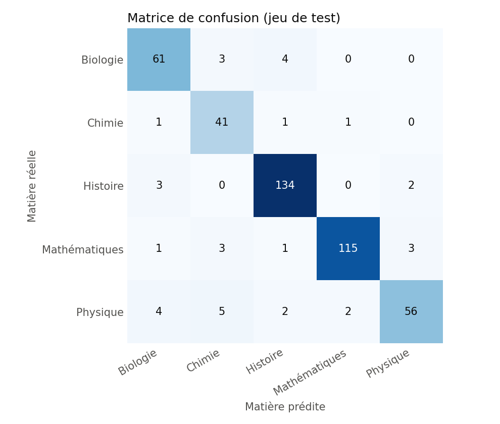
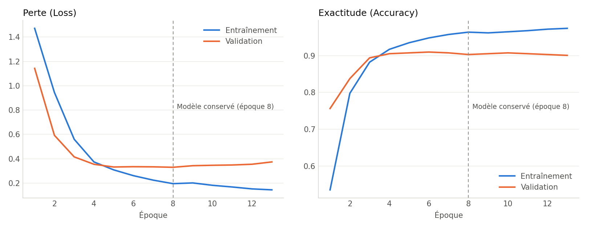

# Classification automatique des questions éducatives

Projet de Deep Learning et de traitement automatique du langage (TALN/NLP) : un réseau de neurones, entraîné à partir de zéro, lit une question en français et prédit sa matière parmi cinq.

> Le système ne répond pas aux questions. Ce n'est pas un chatbot : c'est un classifieur.

## 1. Lancer l'application

Depuis le dossier `educational-classifier`, avec l'environnement déjà installé :

```bash
.venv/bin/streamlit run app.py
```

L'application s'ouvre sur `http://localhost:8501`. Si Streamlit demande une adresse e-mail au premier lancement, appuyez simplement sur Entrée.

### Tout refaire depuis le début

Il faut Python 3.10 à 3.12, car TensorFlow 2.16 n'est pas disponible pour Python 3.13.

```bash
python3.10 -m venv .venv
.venv/bin/pip install --upgrade pip   # indispensable : l'installation a échoué avec pip 22.3
.venv/bin/pip install -r requirements.txt
.venv/bin/python -m src.data_loader   # télécharge et sépare les données
.venv/bin/python -m src.train         # entraîne le modèle (moins d'une minute sur CPU)
.venv/bin/python -m src.evaluate      # calcule les métriques et les graphiques
.venv/bin/streamlit run app.py
```

## 2. Le problème et l'objectif

Trier des questions par matière à la main prend du temps. Le **problème** est une **classification de texte multiclasse** : à une question, on associe une seule matière parmi Biologie, Chimie, Histoire, Mathématiques et Physique.

L'**objectif** est de construire toute la chaîne : données réelles, prétraitement, réseau de neurones appris à partir de zéro, évaluation sur des données jamais vues et application web.

## 3. Le dataset

### Pourquoi pas ScienceQA ?

Le dataset envisagé au départ, [ScienceQA](https://huggingface.co/datasets/derek-thomas/ScienceQA), a été examiné puis écarté pour deux raisons :

- il ne contient **aucune question de mathématiques**, et seulement 361 questions d'histoire sur 12 726 ;
- il est **uniquement en anglais**, alors que l'application doit traiter des questions en français.

### Le dataset retenu : MMMLU en français

[openai/MMMLU](https://huggingface.co/datasets/openai/MMMLU), configuration `FR_FR` (licence MIT), contient 14 042 questions de MMLU traduites par des **traducteurs professionnels**, réparties en 57 sous-matières. La révision du dépôt est figée dans le code pour que chacun télécharge les mêmes données.

Seules les colonnes `Question` et `Subject` sont utilisées. Aucune question n'est créée ni réétiquetée à la main : quinze sous-matières existantes sont simplement regroupées.

| Matière | Sous-matières d'origine |
|---|---|
| Mathématiques | abstract_algebra, college_mathematics, elementary_mathematics, high_school_mathematics |
| Biologie | college_biology, high_school_biology |
| Physique | college_physics, conceptual_physics, high_school_physics |
| Chimie | college_chemistry, high_school_chemistry |
| Histoire | high_school_european_history, high_school_us_history, high_school_world_history, prehistory |

### Préparation et séparation

3 023 questions correspondent à ces sous-matières. Après retrait des doublons, il en reste **2 950**. Sans ce retrait, une même question pourrait se retrouver à la fois à l'entraînement et au test, ce qui gonflerait les résultats.

La séparation 70 / 15 / 15 est stratifiée : chaque ensemble garde les proportions de chaque matière.

| Matière | Entraînement | Validation | Test | Total |
|---|---:|---:|---:|---:|
| Histoire | 649 | 139 | 139 | 927 |
| Mathématiques | 571 | 123 | 123 | 817 |
| Physique | 320 | 69 | 69 | 458 |
| Biologie | 318 | 68 | 68 | 454 |
| Chimie | 206 | 44 | 44 | 294 |
| **Total** | **2 064** | **443** | **443** | **2 950** |

## 4. Les étapes du TALN

Exemple avec « Quelle est la composition chimique de l'eau ? » (code : `src/preprocessing.py`).

1. **Nettoyage** : minuscules et retrait des accents, pour que « Théorème » et « theoreme » soient le même mot.
2. **Tokenisation** : découpage en jetons. Les symboles mathématiques utiles (`=`, `+`, `^`...) sont gardés et tous les nombres deviennent le jeton `<num>`.
3. **Retrait des mots-outils** : « le », « de », « est »... sont présents partout et aident peu à distinguer les matières. Il reste `quelle | composition | chimique | eau`.
4. **Vocabulaire et séquences numériques** : chaque mot reçoit un numéro. Le vocabulaire est construit **sur l'entraînement seul**, pour ne rien apprendre du test. Les mots vus au moins deux fois sont gardés, soit 8 000 entrées au total. Les autres partagent le numéro `1` (mot inconnu).
5. **Padding** : le réseau reçoit des séquences de même longueur. Chacune est tronquée ou complétée par des `0` jusqu'à **60 valeurs**.

## 5. L'architecture du réseau

Code : `src/model.py`. Le modèle compte **514 245 paramètres**, tous appris pendant notre entraînement.

| Couche | Sortie | Paramètres | Rôle |
|---|---|---:|---|
| Embedding | (60, 64) | 512 000 | Transforme chaque mot en vecteur de 64 nombres, initialisé au hasard |
| Global Average Pooling | (64) | 0 | Fait la moyenne des vecteurs pour résumer la question en un seul vecteur |
| Dropout (40 %) | (64) | 0 | Éteint des neurones au hasard pendant l'entraînement |
| Dense (ReLU) | (32) | 2 080 | Combine les informations du résumé |
| Dropout (40 %) | (32) | 0 | Même rôle que ci-dessus |
| Dense (Softmax) | (5) | 165 | Donne une probabilité par matière, dont la somme vaut 1 |

Deux détails à savoir expliquer :

- **Masque de padding** (`mask_zero=True`) : les `0` ajoutés ne comptent pas dans la moyenne. Sinon, une question courte serait noyée dans le remplissage.
- **Dropout et régularisation L2** : ils s'ajoutent à l'architecture de départ pour limiter le surapprentissage, car le dataset est petit.

**Limite du modèle :** la moyenne ne tient pas compte de l'ordre des mots. Le réseau voit un « sac de mots » dont il a appris le sens pour la tâche.

## 6. L'entraînement

Code : `src/train.py`.

1. **Passe avant** : le réseau prédit des probabilités pour un lot de 32 questions.
2. **Perte** : l'entropie croisée (`sparse_categorical_crossentropy`) mesure l'écart avec la bonne matière.
3. **Rétropropagation** : on calcule comment chaque poids a contribué à l'erreur.
4. **Mise à jour** : l'optimiseur Adam (taux d'apprentissage 0,001) corrige les poids.

Trois mécanismes complètent ce cycle :

- **Poids de classes** : une erreur sur une matière rare compte davantage, ce qui compense le déséquilibre (294 questions de chimie, 927 d'histoire).
- **Arrêt anticipé** : l'entraînement s'arrête quand la perte de validation ne progresse plus depuis 6 époques. Ici, il a duré 17 époques et le modèle de l'**époque 11** a été conservé.
- **Graine aléatoire fixe** : relancer toute la chaîne depuis zéro a redonné exactement les mêmes métriques.

**Réglages et rigueur :** les choix ont été faits sur la validation, jamais sur le test. Par exemple, une longueur de 60 a été préférée à 160 d'après la perte de validation moyenne sur 3 graines (0,351 contre 0,364). Le jeu de test n'a servi qu'une fois ces réglages figés.

## 7. Les métriques et les résultats

Les résultats ci-dessous sont calculés par `src/evaluate.py` sur les **443 questions de test** et enregistrés dans `models/metrics.json`.

- **Exactitude** : part des questions bien classées.
- **Précision** : quand le modèle annonce une matière, à quelle fréquence a-t-il raison ?
- **Rappel** : parmi les questions d'une matière, quelle part retrouve-t-il ?
- **Score F1** : moyenne harmonique de la précision et du rappel.
- **Moyenne macro** : donne le même poids à chaque matière, même rare. C'est utile ici, car les classes sont déséquilibrées.

| Mesure | Résultat |
|---|---:|
| Exactitude | **89,2 %** (intervalle de confiance à 95 % : 85,9 % à 91,7 %) |
| Référence : toujours prédire la matière la plus fréquente | 31,4 % |
| Précision macro | 0,866 |
| Rappel macro | 0,874 |
| F1 macro | 0,869 |

| Matière | Précision | Rappel | F1 | Questions |
|---|---:|---:|---:|---:|
| Mathématiques | 0,950 | 0,935 | 0,943 | 123 |
| Histoire | 0,948 | 0,921 | 0,934 | 139 |
| Physique | 0,864 | 0,826 | 0,844 | 69 |
| Biologie | 0,787 | 0,868 | 0,825 | 68 |
| Chimie | 0,783 | 0,818 | 0,800 | 44 |





**Lecture des courbes :** en fin d'entraînement, l'exactitude atteint environ 99 % sur l'entraînement et 90 % en validation. Cet écart montre un surapprentissage : le modèle mémorise en partie ses données. L'arrêt anticipé évite que la perte de validation continue à remonter.

## 8. Les limites à connaître

Il vaut mieux présenter ces limites soi-même : elles font partie du résultat.

- **Le score global est un peu flatteur pour une démonstration.** Les questions d'histoire sont souvent de longs extraits de documents (médiane de 97 jetons, contre 17 au plus ailleurs), plus faciles à classer. L'exactitude est de **87,2 %** sur les questions courtes (30 jetons ou moins, n = 328) et de **94,8 %** sur les longues (n = 115). En histoire, elle passe de 100 % sur les longues à 79,6 % sur les courtes.
- **Le vocabulaire est limité par la petite taille du dataset.** Le mot « dérivée » n'apparaît pas assez à l'entraînement pour entrer dans le vocabulaire.
- **Certains exemples simples sont mal classés.** Résultats des cinq exemples de la consigne :

| Question | Attendu | Prédit | Confiance |
|---|---|---|---:|
| Qu'est-ce que la photosynthèse ? | Biologie | Biologie | 99,8 % |
| Expliquez la deuxième loi de Newton. | Physique | Physique | 98 % |
| Quelles sont les causes de la Seconde Guerre mondiale ? | Histoire | Histoire | 99 % |
| Calculez la dérivée de x². | Mathématiques | **Biologie (erreur)** | 43,3 % |
| Quelle est la composition chimique de l'eau ? | Chimie | **Biologie (erreur)** | 56 % |

- **La confiance n'est pas une garantie.** « Quelle est la fonction des mitochondries ? » est classée en Mathématiques avec 88 % de confiance. Le mot « fonction » est sans doute en cause, mais cette explication n'a pas été vérifiée. L'application avertit sous 60 % de confiance : sur la validation, le modèle réussit 52,9 % de ces cas (34 questions), contre 92,9 % au-dessus de ce seuil.
- **Le modèle choisit toujours parmi les cinq matières**, même pour une question hors sujet, tant qu'elle contient au moins un mot connu.
- **Les étiquettes sont celles de la sous-matière d'origine.** Une partie des erreurs est donc discutable : les 9 questions d'histoire classées en biologie viennent toutes de `prehistory`, et certaines portent sur l'évolution humaine.
- **Le test reste petit** (443 questions, dont 44 en chimie). Les scores par matière sont donc à lire comme des ordres de grandeur.

**Améliorations possibles :** davantage de données en français pour le vocabulaire, une racinisation (« dérivée » et « dérivées » deviendraient le même mot), ou un modèle tenant compte de l'ordre des mots (CNN, LSTM).

## 9. Pourquoi ce projet relève du Deep Learning et du TALN

**Deep Learning :**

- le modèle est un réseau de neurones à plusieurs couches, entraîné par rétropropagation du gradient ;
- il apprend lui-même ses représentations : les embeddings ne sont pas programmés à la main, mais ajustés pour réussir la tâche ;
- tous les poids partent de valeurs aléatoires, sans BERT, sans GPT, sans modèle préentraîné ni API externe.

**TALN (NLP) :**

- la donnée d'entrée est du langage humain, ici le français ;
- le projet applique la chaîne classique du domaine : nettoyage, tokenisation, mots-outils, vocabulaire, séquences et plongements lexicaux ;
- la tâche, la classification de texte, est un problème classique du TALN.

## 10. Organisation du projet

```text
educational-classifier/
├── data/
│   ├── raw/                  # dataset téléchargé
│   └── processed/            # train.csv, val.csv, test.csv
├── models/                   # modèle, vocabulaire, métriques, graphiques
├── notebooks/
│   └── exploration.ipynb     # exploration du dataset, déjà exécutée
├── src/
│   ├── data_loader.py        # téléchargement, sélection, séparation
│   ├── preprocessing.py      # nettoyage, tokenisation, séquences, padding
│   ├── model.py              # architecture du réseau
│   ├── train.py              # entraînement
│   └── evaluate.py           # métriques et graphiques sur le test
├── app.py                    # application Streamlit
├── requirements.txt
└── README.md
```

## 11. Déroulé conseillé pour la démonstration

1. **Le problème** : montrer l'onglet « Classifier » et préciser que ce n'est pas un chatbot.
2. **Une prédiction** : cliquer sur un exemple, puis sur « Classifier », et lire le graphique des probabilités.
3. **Le TALN** : ouvrir « Voir le prétraitement de cette question » pour montrer les jetons et la séquence numérique.
4. **Le modèle et les données** : passer par l'onglet « Données et modèle ».
5. **Les résultats** : commenter les courbes et la matrice de confusion dans l'onglet « Performances ».
6. **Les limites** : saisir « Calculez la dérivée de x². », montrer l'avertissement de confiance faible et expliquer que « dérivée » est absent du vocabulaire.
